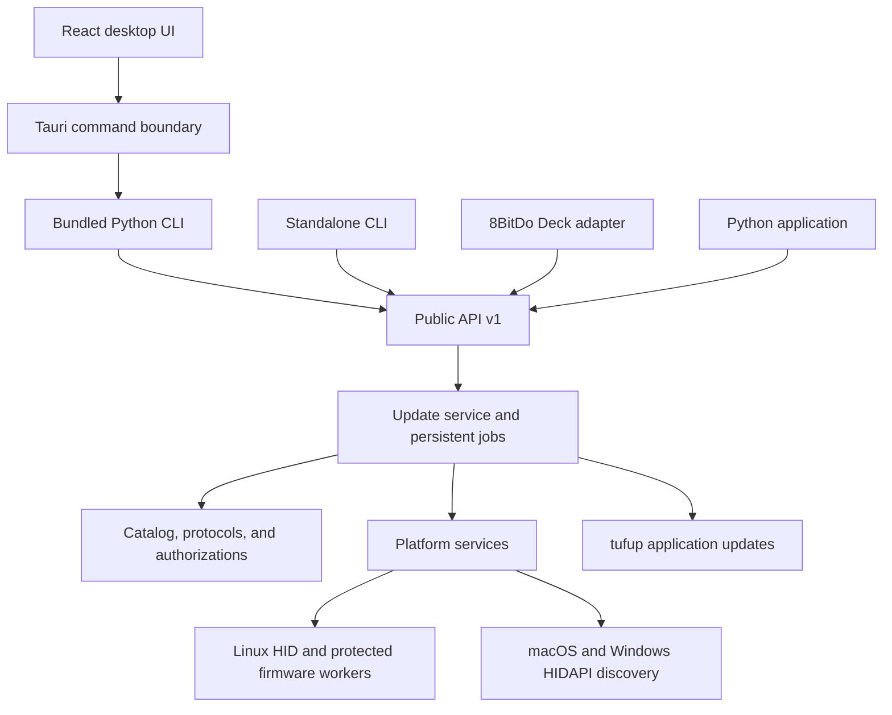

# Shared updater architecture

The Python backend owns device identity, firmware policy, jobs, and recovery. The desktop application, CLI, Python API, and Decky are frontends. Packaging the backend with Python lets users run it without installing an interpreter; Rust provides the desktop shell without rewriting the firmware protocols.

## Frontend boundaries

`eightbitdo.api.UpdaterAPI` exposes a fixed operation set, validates parameters and confirmations, and returns versioned JSON results or errors. The CLI's `api` command exposes that contract to other processes. No network daemon is required. Ordinary CLI commands preserve their direct JSON output; integrations should use the [versioned API envelope](api.md).

The desktop React app is built with Vite. Its Rust shell accepts only allowlisted operations and passes parameters as one JSON argument to the packaged `eightbitdo` sidecar. The webview has no generic shell-execution permission. Browser previews cannot access devices. The sidecar returns API envelopes; the shell checks their version before returning them to React.

Decky keeps its existing adapter and controller-focus controls. The desktop and Decky share types, visual tokens, and artwork in `src/shared/`. The original SVG illustrations depict specific models; colors are illustrative and never identify hardware. Firmware support decisions remain in the backend.

The packaged desktop's `--smoke-test` mode creates no webview. It calls only sidecar `info`, checks the API/application versions, and exits. It cannot mount the React app or trigger its initial device scan.

## Platform boundary

`eightbitdo.platform.current_platform()` chooses `LinuxPlatform` or `DesktopPlatform`. `Service(..., platform=...)` accepts an implementation for testing. Platform services own device access, worker launch/liveness, permissions, and browser integration; `eightbitdo.runtime` handles frozen-process detection and sanitizes the environment passed to host executables.

Linux uses hidraw/sysfs, its existing device-correlation and reconnect logic, scoped udev access, and systemd user services. macOS and Windows use HIDAPI for discovery and reviewed runtime identity/version queries. They support firmware catalogs and preparation, but refuse native writes, boot transitions, recovery, fwupd, and extended wireless probes. Making those operations available requires host-specific physical-port correlation, boot/reconnect validation, suspend prevention, and hardware evidence; sharing the transport interface does not establish those properties.

`info.capabilities` reports the host boundary. Individual jobs still require their own compatible device, exact source/destination image authorization, and access checks. A true platform capability is not a hardware qualification.

`eightbitdo.locking` uses POSIX file locks on Linux/macOS and portalocker on Windows. Worker identity uses Linux process start information or psutil creation time on macOS/Windows, preventing PID reuse from masquerading as the original worker.

## Jobs and process lifetime

Frontends submit background work and poll durable jobs. Linux retains `~/.local/state/eightbitdo-deck/`, or `$XDG_STATE_HOME/eightbitdo-deck/`, so existing jobs and caches need no migration. macOS and Windows use `platformdirs.user_state_path("8BitDo Updater", appauthor=False)`. Frontends on the same host share default state and locks. Separate state directories have independent locks and must not target the same hardware concurrently.

Preparation does not flash. Eligible Linux installation and recovery workers run through the systemd user manager with suspend inhibition. The backend refuses to write without that protection. A worker retains target/source context, revalidates the cached image and authorization, and checks the returning device version before reporting completion.

Source and installed-Python workers use the calling interpreter. A frozen executable reexecutes its own private worker mode with `PYINSTALLER_RESET_ENVIRONMENT=1` and an independent extraction lifetime. Decky's frozen host is detected separately and launches the packaged backend using host Python. Preparation workers detach with a new POSIX session or Windows detached-process flags. Closing a frontend does not intentionally cancel submitted workers; interruption does not trigger automatic firmware retries.

Keep application files, USB, and power intact while firmware jobs run. Application self-updates use an interprocess exclusion lock and reject queued or active firmware work. A pending app replacement blocks new firmware jobs until it completes or is recovered.

## Application update boundary

`eightbitdo.selfupdate` uses tufup/TUF to verify signed application metadata and payloads. Each product/OS/architecture has a separate repository history. The trusted application identity and install path come from the running executable; the desktop shell supplies its own fixed installation path and PID. Frontend API callers cannot choose arbitrary update servers or destinations.

A desktop update replaces the complete AppImage, macOS `.app`, or Windows application directory, including the sidecar. It stages verified files, waits for the GUI and sidecar to exit, and retains a backup during replacement. This is separate from firmware download or installation. Details, pending-update recovery, and key rotation are in [application self-updates](self-updates.md).

## Distribution boundaries

The Python wheel/source distribution contains the shared backend, CLI, permission helper, and public update-trust resources. PyInstaller bundles the Python runtime and platform dependencies. Tauri bundles the desktop UI and that executable. The Decky ZIP contains its frontend, adapter, and shared backend; its existing permission-helper entrypoint remains available.

Firmware images, private captures, and device dumps are not release inputs. Application versions, OS installers, TUF signatures, and build attestations do not broaden the firmware authorization registry. macOS and Windows packages currently lack OS publisher signing/notarization; TUF signatures authenticate app updates independently of those mechanisms.

See [releasing.md](releasing.md) for builds and [protocol.md](protocol.md#authorization-and-hardware-qualification) for firmware qualification requirements.
