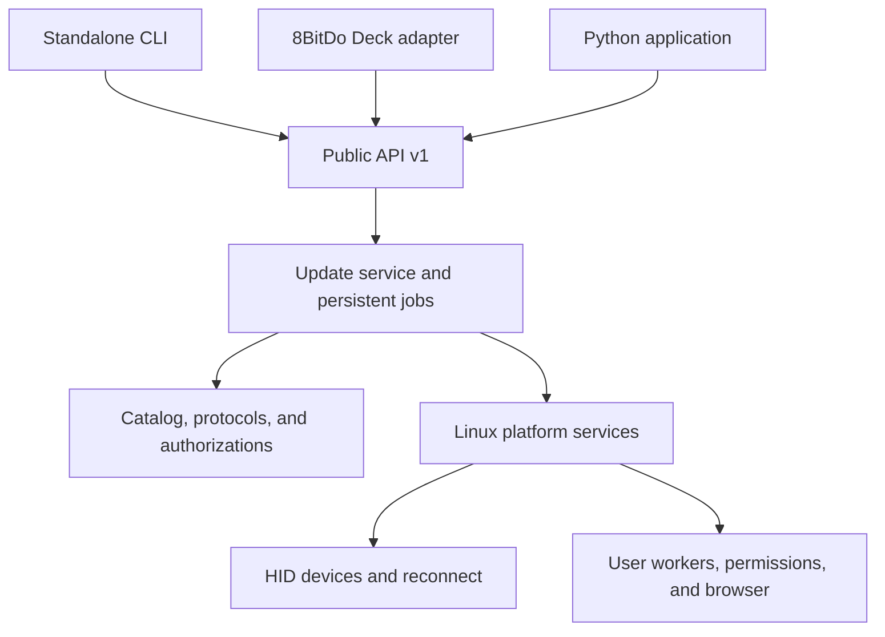

# Shared updater architecture

The project keeps firmware logic in a shared Python backend and treats the command line and Decky as frontends. Another frontend can use the same public API without implementing firmware policy or depending on Decky. The standalone executable bundles the Python interpreter; it does not change the firmware transaction.

## Public boundary

`eightbitdo.api.UpdaterAPI` is the frontend boundary. It exposes a fixed set of operations, validates their parameters and confirmation requirements, and returns versioned JSON results or errors. The CLI's `api` command exposes the same contract to processes that cannot import Python. Neither route starts a network server.

The Decky adapter translates its existing calls through that boundary. The plugin keeps its name and UI, but does not own device compatibility decisions. Ordinary CLI commands preserve their direct JSON output for existing callers; integrations should use the versioned envelope described in [the API reference](api.md).

`Service` orchestrates catalog selection, preparation, installation, and recovery. It and the protocol modules enforce exact firmware/source authorizations, target checks, locking, verification, and reconnect checks. A frontend confirmation permits the requested operation to be considered; it cannot make incompatible firmware installable.

## Platform boundary

`eightbitdo.platform.LinuxPlatform` owns host-dependent operations such as worker launch, process liveness, browser selection, and access to the Linux discovery/transport/reconnect helpers. `Service(..., platform=...)` accepts a platform implementation so tests and future ports can replace those operations without duplicating the update workflow. `eightbitdo.runtime` handles frozen-process detection and sanitizes the environment passed to host executables.

The shipped implementation still uses Linux HID, sysfs, udev access policy, and systemd user services. Persistent job locking uses POSIX `fcntl`, and worker process identity uses Linux process information outside the adapter. A macOS or Windows port therefore needs storage/worker changes as well as a platform implementation. It must preserve physical-device correlation, locking, permission checks, suspend prevention, and worker behavior, and must be tested on that OS before making a support claim.

Permission setup is a separately authorized host action. The plugin and standalone application run as the desktop user. Recovery rules remain restricted to the reviewed interfaces; packaging does not grant wider USB access or enable additional firmware targets.

## Jobs and process lifetime

Frontends submit work and poll persistent jobs. By default, every frontend uses `~/.local/state/eightbitdo-deck/`, or the equivalent under `$XDG_STATE_HOME`. The original directory name is retained to preserve existing jobs, caches, and locks. Avoid simultaneous use of separate state directories against the same device because their locks are independent.

Preparation does not flash. Installation and applicable recovery workers run through the systemd user manager with suspend inhibition. The application fails rather than proceeding without the required protection. The worker retains its original target/source context, revalidates the cached image and authorization, and verifies the destination version before reporting completion.

Source and installed-Python launches use the same interpreter as the calling application. The standalone frozen executable reexecutes itself in a private worker mode with `PYINSTALLER_RESET_ENVIRONMENT=1`, instead of depending on a system Python installation. Decky's frozen host is detected separately and uses the host's Python to launch the packaged backend. The private worker entry is not a public API operation and does not remove job-state or recovery-confirmation checks. An independently launched frozen worker owns its extraction lifetime so closing the submitting CLI cannot remove files the worker still needs.

Closing a frontend is distinct from deleting or replacing its executable, environment, or plugin files. Keep those files and the USB/power connection intact while a job runs. A stopped worker is reported as an interruption; it does not cause an automatic firmware retry.

## Distribution boundaries

The Python wheel/source distribution contains the backend, CLI, and `eightbitdo/resources/install-udev-rules.sh`. The PyInstaller executable contains the same Python application and runtime. The Decky ZIP contains the shared backend plus its frontend assets and adapter; the previous `scripts/install-udev-rules.sh` entrypoint forwards to the packaged helper. Firmware downloads, private captures, and device dumps are not release inputs.

The Linux executable still depends on its documented host ABI and system services. Optional `fwupd` support uses the host's service and trust policy. Opening a browser is a convenience operation; it is not a verified recovery route for every model.

Build and release procedures are in [releasing.md](releasing.md). Device support and hardware qualification remain governed by [protocol.md](protocol.md#authorization-and-hardware-qualification), independently of which frontend or package is used.
